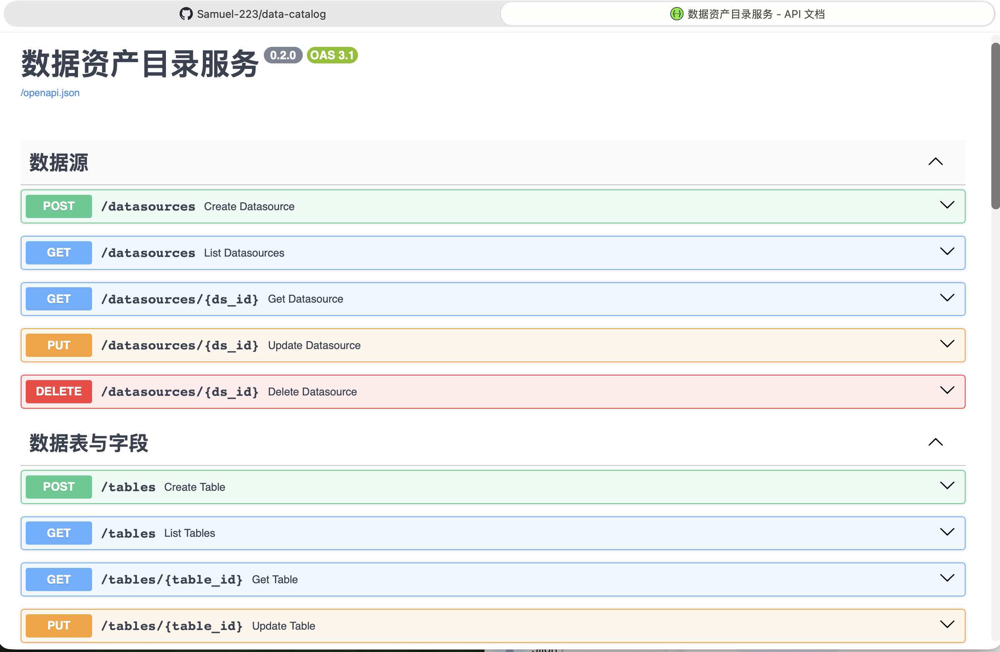

# 数据资产目录与质量校验服务

面向数据治理场景的后端服务：登记数据资产元数据、配置质量规则并执行校验、追溯字段级血缘关系。




## 能力矩阵

| 模块 | 能力 | 关键实现 |
|---|---|---|
| 数据源管理 | 数据源增删改查，记录类型与归属人 | 唯一约束 + Pydantic 双层校验 |
| 元数据管理 | 数据源 → 表 → 字段 三级登记，字段级敏感标识 | 声明式关系 + 级联删除 |
| 数据质量 | 非空 / 唯一 / 值域 三类规则，执行结果留存 | 规则与数据解耦，值集可替换 |
| 数据血缘 | 字段级上下游登记、向上溯源、向下推影响 | 单向存储 + BFS + 深度上限 |
| 可观测性 | 健康/就绪探针、请求 ID、结构化日志、统一错误体 | 中间件 + contextvar + JSON 日志 |
| 权限与审计 | API Key / OIDC 双模式 + viewer/editor/admin 三级角色，写操作双落库（表 + JSONL） | 方法推导授权 + JWT 验签 + 审计钩子 |
| 工程化 | 锁定依赖、Alembic 迁移、ruff 检查、CI、覆盖率 | Makefile 一条命令到位 |

## 快速开始

### 方式一：Docker（含 PostgreSQL）

```bash
docker compose up --build -d      # api:8000 + postgres:16
curl -s http://127.0.0.1:8000/ready
```

### 方式二：本地（SQLite，零依赖）

```bash
python3 -m venv .venv && source .venv/bin/activate
pip install -r requirements-dev.txt
make seed        # 灌入演示数据：2 数据源 / 5 表 / 21 字段 / 3 规则
make run         # http://127.0.0.1:8000/docs
```

### 常用命令

```bash
make test        # 28 项单测
make cov         # 覆盖率报告
make lint fmt    # 检查与格式化
make migrate     # Alembic 升级到最新
```

## 三分钟验证

```bash
# 1) 建数据源
curl -s -X POST http://127.0.0.1:8000/datasources \
  -H 'Content-Type: application/json' \
  -d '{"name":"ods_mysql","type":"mysql","host":"10.0.0.12:3306","owner":"demo"}'

# 2) 建表、建规则、执行校验
curl -s -X POST http://127.0.0.1:8000/rules \
  -H 'Content-Type: application/json' \
  -d '{"table_id":1,"rule_type":"not_null"}'
curl -s -X POST http://127.0.0.1:8000/rules/1/run \
  -H 'Content-Type: application/json' \
  -d '{"values":["a",null,"c"]}'
# → {"passed":false,"abnormal_count":1,"detail":"总数 3，空值 1"}

# 3) 看错误体形状（统一结构，带 request_id）
curl -i http://127.0.0.1:8000/datasources/999999
# → HTTP 404, {"error":{"code":"not_found","message":"…","request_id":"…"},"detail":"…"}
```

## 接口一览

| 方法 | 路径 | 说明 |
|---|---|---|
| GET | `/health` `/ready` | 存活 / 就绪（含 DB 连通性） |
| GET | `/audit` | 审计查询（仅 admin，按人/方法/路径过滤） |
| GET | `/auth/whoami` | 当前身份与角色（排障/前端用） |
| GET | `/` | 服务信息与入口 |
| POST | `/datasources` | 创建数据源 |
| GET | `/datasources` | 分页查询（skip/limit） |
| GET/PUT/DELETE | `/datasources/{id}` | 查单个 / 更新 / 删除 |
| POST | `/tables` | 创建数据表 |
| GET | `/tables` | 按数据源查询 |
| POST/GET | `/tables/{id}/columns` | 字段创建 / 列表 |
| POST | `/rules` | 配置质量规则（not_null/unique/range） |
| GET | `/rules` | 规则查询（按表 / 启用状态） |
| DELETE | `/rules/{id}` | 删除规则 |
| POST | `/rules/{id}/run` | 执行校验并落库 |
| GET | `/rules/{id}/results` | 校验历史 |
| POST | `/lineage` | 登记字段血缘 |
| GET | `/lineage/{id}/upstream` | 向上溯源 |
| GET | `/lineage/{id}/downstream` | 向下影响范围 |

完整字段与示例见 [`docs/api.md`](docs/api.md)。

## 工程结构

```
app/
├── core/            # 配置、日志、中间件、错误处理
├── routers/         # datasources / tables / rules / lineage / health
├── models.py        # 5 张表：datasource / table_meta / column_meta / quality_rule / quality_result
├── schemas.py       # Pydantic v2 入出参
├── db.py            # 引擎与会话（连接池可调）
└── main.py          # 应用装配
migrations/          # Alembic 迁移（0001_init）
scripts/seed_demo.py # 演示数据
tests/               # 28 项单元与集成测试
automation/          # 34 项 HTTP 黑盒接口自动化
security/            # 16 项安全检查
perf/ compat/        # 压测与时序、客户端兼容
```

架构与设计取舍见 [`docs/architecture.md`](docs/architecture.md)，开发与调试见 [`docs/development.md`](docs/development.md)。

## 质量保障

| 维度 | 规模 | 结果 |
|---|---|---|
| 单元 / 集成（`tests/`） | 46 项 | 全通过，覆盖率 87% |
| 接口自动化（`automation/`） | 34 项 | 全通过 |
| 安全检查（`security/`） | 16 项 | 13 通过 / 3 项已知缺口 / 0 可被利用 |
| 数据一致性 | 2 项（含篡改反证） | 接口输出与库表逐字段一致 |
| 性能 | 50/100/200 并发 | TPS 1194 / 1170 / 超限超时 |
| Linux/容器基线 | 20 项（`security/linux_security_check.py`） | 17 PASS / 0 FAIL / 1 INFO / 2 SKIP |
| 权限与审计 | 8 项（`tests/test_authz.py`） | 401/403/角色矩阵/审计落库/审计查询权限全通过 |
| OIDC | 9 项（`tests/test_oidc.py`） | 过期/错误 aud/错误 iss/无角色/HS256 无密钥/双模式全部按预期拒绝 |
| CI | GitHub Actions | lint + test + coverage + docker build |

明细与复现方式见 [`docs/testing.md`](docs/testing.md)；主机与容器侧见 [`docs/linux-security.md`](docs/linux-security.md)。

```bash
make sec   # Linux/容器安全基线，20 项，有 FAIL 则退出码 1
```

## 权限与审计

```bash
# 方式一：API Key
export AUTH_MODE=apikey
export API_KEYS="admin:$(python -m app.core.security admin),editor:$(python -m app.core.security editor)"

# 方式二：OIDC 单点（Keycloak / Azure AD）
export AUTH_MODE=oidc
export OIDC_ISSUER=https://sso.corp.com/realms/data-catalog
export OIDC_AUDIENCE=data-catalog-api
```

| 角色 | 读 | 写 | 删 | 查审计 |
|---|---|---|---|---|
| viewer | ✅ | ❌ | ❌ | ❌ |
| editor | ✅ | ✅ | ❌ | ❌ |
| admin | ✅ | ✅ | ✅ | ✅ |

写操作与 401/403 同时落 `audit_log` 表与 `${AUDIT_LOG_PATH}` 的 JSONL，
审计带 `request_id`，密钥只记前 6 位指纹。

```bash
make audit-report          # 纯 shell 报表：按人、按状态码、越权尝试、最近记录
```

运维件在 `deploy/`：logrotate、auditd 规则、systemd 单元。设计说明见 [`docs/audit-and-rbac.md`](docs/audit-and-rbac.md)，
单点接入与排障见 [`docs/oidc.md`](docs/oidc.md)。

## 错误模型与可观测性

```json
{
  "error": {"code": "not_found", "message": "数据源不存在", "request_id": "a1b2c3d4e5f6"},
  "detail": "数据源不存在"
}
```

- 所有失败统一形状，调用方只需解析一个结构；`detail` 字段保留以兼容旧调用方
- 每次响应带 `X-Request-ID` 与 `X-Process-Time-ms`，透传客户端传入的 ID
- 日志一行一个 JSON，含 `request_id` / `method` / `path` / `status` / `duration_ms`
- `/health` 只看进程，`/ready` 才查数据库，容器编排可区分两类故障

## 部署与迁移

```bash
alembic upgrade head                 # 生产：显式迁移
AUTO_CREATE_SCHEMA=0 docker compose up -d   # 关闭自动建表，交给迁移
alembic revision --autogenerate -m "add xxx"  # 新增变更
```

配置全部来自环境变量，样例见 [`.env.example`](.env.example)。

## 已知边界

1. 无鉴权：接口未做认证授权，仅适用于内网或演示环境（路线图第一项）
2. 无速率限制与安全响应头
3. 校验的数据来源目前是请求体传入的值集，尚未接入真实数据库连接器
4. 单个应用实例，横向扩展需前置 PgBouncer 或读写分离

## License

MIT
