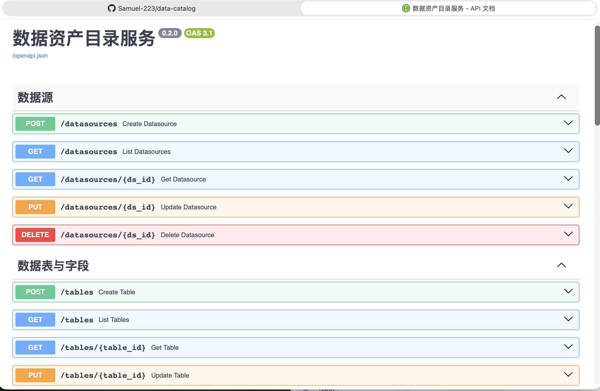

# 数据资产目录与质量校验服务

面向数据治理场景的后端服务：登记数据资产元数据、配置质量规则并执行校验、追溯字段级血缘关系。

## 功能

| 模块 | 能力 |
|---|---|
| 数据源管理 | 数据源增删改查，记录类型标识（MySQL / PostgreSQL / Hive 等）与归属人 |
| 元数据管理 | 数据源 → 数据表 → 字段 三级登记，字段级敏感标识 |
| 数据质量 | 非空 / 唯一 / 值域 三类规则配置，执行结果持久化 |
| 数据血缘 | 字段级上下游登记，向上追溯与向下影响范围查询 |

## 技术栈

- Python 3.12+（本地开发环境为 3.14，容器镜像使用 `python:3.12-slim`）
- FastAPI / Uvicorn
- SQLAlchemy 2.x（DeclarativeBase + Mapped 类型注解）
- Pydantic v2 入参校验
- SQLite（本地开发）/ PostgreSQL 16（容器部署）
- Docker + Docker Compose

## 快速开始

### 本地运行

```bash
python3 -m venv apienv
source apienv/bin/activate
pip install -r requirements.txt
uvicorn app.main:app --host 0.0.0.0 --port 8000

容器运行
docker compose up --build

交互文档：http://127.0.0.1:8000/docs

接口一览
方法	路径	说明
POST	/datasources	创建数据源
GET	/datasources	分页查询数据源
GET	/datasources/{id}	查询单个数据源
PUT	/datasources/{id}	更新数据源
DELETE	/datasources/{id}	删除数据源
POST	/tables	创建数据表
GET	/tables	按数据源查询数据表
POST	/tables/{id}/columns	创建字段
GET	/tables/{id}/columns	查询字段列表
POST	/rules	配置质量规则
GET	/rules	查询规则
DELETE	/rules/{id}	删除规则
POST	/rules/{id}/run	执行校验
GET	/rules/{id}/results	查询校验历史
POST	/lineage	登记字段血缘
GET	/lineage/{id}/upstream	向上追溯
GET	/lineage/{id}/downstream	向下查影响范围

三分钟演示
# 1. 登记一个数据源
curl -s -X POST http://127.0.0.1:8000/datasources \
  -H "Content-Type: application/json" \
  -d '{"name":"ods_mysql","type":"mysql","host":"127.0.0.1","owner":"demo"}'

# 2. 配置非空规则并执行
curl -s -X POST http://127.0.0.1:8000/rules \
  -H "Content-Type: application/json" \
  -d '{"table_id":1,"rule_type":"not_null"}'

curl -s -X POST http://127.0.0.1:8000/rules/1/run \
  -H "Content-Type: application/json" \
  -d '{"values":["a", null, "c"]}'

设计说明
- **三级元数据模型**：数据源 → 数据表 → 字段，字段级 `is_sensitive` 为脱敏策略提供元数据依据
- **规则与数据解耦**：校验以「值集 + 规则」为输入，数据获取层可替换，接入真实数据库时无需改动规则逻辑
- **血缘单向存储**：仅保存上游引用，下游通过反查推导，避免双向存储不一致；BFS + 深度上限规避环形血缘
- **级联删除**：`cascade="all, delete-orphan"` 保证删除数据源时不残留元数据
- **双层校验**：数据库约束 + Pydantic 入参校验，约束冲突统一转为 400 响应

测试
pip install -r requirements-dev.txt
python -m pytest

19 个用例全部通过，覆盖：

- 数据源 CRUD 全流程与 404 边界
- 数据表、字段创建
- 三类质量规则的创建与执行（含通过与不通过两种结果）
- 校验结果历史留存
- 血线上游追溯与下游影响范围查询
- 自引用血缘、非法规则类型等异常入参校验

测试通过 `dependency_overrides` 替换数据库依赖，使用独立 SQLite 文件，
每个用例前重建表结构，不触碰开发库数据。

目录结构
app/
├── __init__.py
├── db.py          引擎与会话
├── models.py      ORM 模型
├── schemas.py     Pydantic 模型
├── main.py        应用入口
└── routers/
    ├── datasources.py
    ├── tables.py
    ├── rules.py
    └── lineage.py
tests/
├── conftest.py
├── test_datasources.py
├── test_rules.py
└── test_lineage.py

容器化部署
`docker compose up --build` 启动两个服务：
服务	说明
api	FastAPI 应用，映射宿主 8000 端口
db	PostgreSQL 16，数据持久化在 pgdata 数据卷
启动顺序由 `depends_on` + `pg_isready` 健康检查保证。数据库地址通过 `DATABASE_URL` 注入，本地默认 SQLite，容器内切换为 PostgreSQL，代码无需修改。
docker compose ps                                            # 状态
docker compose logs -f api                                   # 日志
docker compose exec db psql -U catalog -d catalog -c "\dt"    # 查看表
docker compose down                                          # 停止
docker compose down -v                                        # 停止并清除数据

注：compose 中的数据库口令为本地演示用弱口令，仅用于开发环境，不代表生产配置。

License

MIT

## 测试实践

被测对象即本项目自身（FastAPI + PostgreSQL）。测试分三层，全部可本地复现。

### 测试分层

| 层级 | 位置 | 手段 | 用例数 |
|---|---|---|---|
| 单元 / 集成（进程内） | `tests/` | `TestClient` + `dependency_overrides` 隔离测试库 | 19 |
| 接口自动化（HTTP 黑盒） | `automation/` | `requests` 直连运行中的服务 | 34 |
| 冒烟 / 契约 | `automation/test_datasources.py` | 校验服务存活与 openapi 路径、操作数 | 2 |

### 覆盖范围

- **数据源**：创建、查询、更新、删除；缺字段返回 422；不存在 ID 返回 404
- **表与字段**：建表、层变更、字段敏感标识、列表包含校验
- **质量规则**：规则创建、执行、结果留存、删除；唯一性规则对重复值的判定
- **血缘**：上游追溯、下游影响面、根字段空链路、缺字段 422

### 如何运行

```bash
sudo docker compose up -d
cd automation
source ../apienv/bin/activate
./run.sh        # 依赖装好时生成 report.html
未安装 `pytest-html` 时会自动降级为 `junitxml` + 本地转换脚本，输出同样的 HTML 报告。

### 测试数据管理

所有测试数据由 `conftest.py` 的 fixture 生成，命名带随机后缀，用例结束自动删除，不污染业务库。

### 已知未覆盖

- 性能测试：尚未引入 JMeter，无并发与 P95 数据
- 安全测试：仅依赖参数校验（422），未编写越权与未授权访问用例
